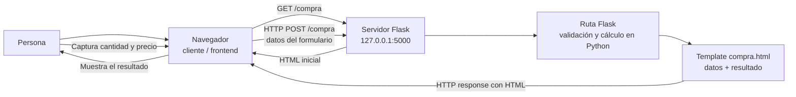

# Explicación técnica y evidencias

## 1. Recorrido de una solicitud en el Portal de Servicios

Cuando una persona escribe la dirección local del portal, el navegador funciona como **cliente** y solicita conectarse al **servidor** que ejecuta la aplicación. En este proyecto se utiliza `http://127.0.0.1:5000`: `127.0.0.1` es la **dirección IP** de la propia computadora y `5000` es el **puerto** donde Flask escucha las conexiones. En un sitio publicado, un nombre de dominio se traduce a la dirección IP del servidor antes de establecer la comunicación.

El navegador utiliza **HTTP** para enviar una **request** (petición) y recibir una **response** (respuesta). Al entrar a Inicio, envía una solicitud GET. El **backend**, escrito en **Python** con **Flask**, compara la URL con una **ruta** registrada, por ejemplo `/compra`, y decide qué función atenderá esa petición.

La respuesta inicial contiene el documento **HTML** que Flask genera a partir de un **template** de Jinja. El **frontend** es la parte que la persona ve en el navegador: la estructura HTML, los estilos **CSS** y los componentes de **Bootstrap** forman las páginas, la barra de navegación y el carrusel. En las calculadoras, la persona captura los datos y envía un formulario con método **POST**. El navegador manda sus valores en la petición, Flask los recibe en el backend y Python valida los datos y realiza el cálculo correspondiente. La aplicación vuelve a renderizar el template con los valores capturados y el resultado, y entrega ese HTML mediante una nueva response HTTP; el navegador lo presenta en pantalla. El JavaScript incluido aquí proviene de Bootstrap y se utiliza para los controles interactivos del menú móvil y del carrusel; los cálculos no dependen de JavaScript, porque se realizan en Python.

## 2. Diagrama de comunicación

El **cliente** es el navegador y el **servidor** es el proceso Flask que escucha en la IP y el puerto configurados. Al enviar el formulario de compra, el navegador hace una petición HTTP POST a la ruta `/compra`. La ruta procesa la cantidad y el precio en Python; el template recibe los datos y el cálculo. Flask devuelve el HTML resultante en la response y el navegador muestra el resumen, sin depender de la consola.

## 3. Interpretación de los cálculos

- **Compra con descuento:** 5 artículos × $250.00 producen un subtotal de $1,250.00. Como es mayor que $1,000.00, se descuenta el 10% ($125.00) y el total queda en **$1,125.00**.
- **Compra sin descuento:** 4 artículos × $250.00 producen $1,000.00. La condición es estrictamente mayor que $1,000.00, por lo que el descuento es $0.00 y el total es **$1,000.00**.
- **Salario con horas extra:** 40 horas × $100.00 más 5 horas extra × $200.00 dan **$5,000.00**.
- **Salario sin horas extra:** 40 horas × $100.00 dan **$4,000.00**.
- **Temperatura:** para 25 °C, la conversión es **77 °F** y **298.15 K**.

## 4. Evidencias de ejecución

Las imágenes de cada pantalla y de los resultados se guardan en [`capturas/`](./capturas/).

| Pantalla / caso | Evidencia |
|---|---|
| Navegación común | [navegacion.png](./capturas/navegacion.png) |
| Inicio y carrusel | [inicio.png](./capturas/inicio.png) |
| Compra con descuento | [calculo_compra.png](./capturas/calculo_compra.png) |
| Compra sin descuento | [compra_sin_descuento.png](./capturas/compra_sin_descuento.png) |
| Salario con horas extra | [salario_semanal.png](./capturas/salario_semanal.png) |
| Salario sin horas extra | [salario_sin_horas_extra.png](./capturas/salario_sin_horas_extra.png) |
| Conversión de temperatura | [conversion_temperatura.png](./capturas/conversion_temperatura.png) |
| Empresa | [empresa.png](./capturas/empresa.png) |
| Servicios | [servicios.png](./capturas/servicios.png) |
| Contacto | [contacto.png](./capturas/contacto.png) |
